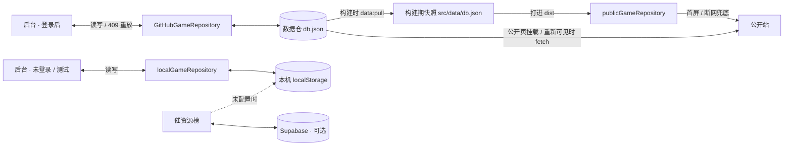

# 架构

技术栈：Vue 3（Composition API）+ Vite 6 + Tailwind CSS 3 + TypeScript，路由用 Hash 模式，
部署为纯静态产物。没有后端服务：数据存在 GitHub 数据仓，后台通过 GitHub API 读写。

## 1. 数据流



**前台 = 快照兜底 + 非阻塞同步。** 首屏读构建期快照（不等网络、断网可用）；公开页挂载、
从后台切回、标签页重新可见时，用一次非阻塞 `fetch` 把内存目录换成数据仓最新内容
（作品与 `taxonomy` 一起 hydrate；词表缺失或结构不可用时保留当前词表）。失败就继续用快照 ——
静态站不能因为数据仓挂了而白屏。

> **不要把前台改成「等网络返回再渲染」** —— 那会赔掉首屏与离线能力。
> 开发 / UI 测试不执行同步，避免网络让断言不稳定。

**后台 = 直接读写数据仓。** 保存一次 = 一次提交，git 历史就是审计日志与回滚手段。
未登录时仓储是本地实现（生产上被登录门禁挡住，只剩测试 / 开发用途）。

**催资源是独立侧链路**：请求数据在 Supabase（或访客本机 localStorage），不参与构建、
不写数据仓。游戏目录始终以 GitHub 数据仓为唯一事实来源。详见 [`INTEGRATIONS.md`](INTEGRATIONS.md)。

### 数据源相关约束

- 前台可见性判断的入参必须是**归一化后**的条目（`AdminGame`）。传原始 `Game` 时
  `status` / `archived` 可能是 `undefined`，比较会静默变成「不可见」，整个前台会无报错地变空。
- **测试里注意两处状态累积**：`localStorage`（本机存档、令牌）会在多次运行间累积，
  UI 测试开头必须 `localStorage.clear()`；登录后数据源是远程仓，
  后台用例必须靠 `page.route` 拦截 GitHub API 才有数据（真令牌不进测试脚本）。

## 2. 前台可见性

**判据只有一个：`isPubliclyVisible(game)` = `status === 'published' && !archived`。**

列表、搜索、筛选、分页、详情页、Hero 收录数、筛选面板的「可用作者 / 年份 / 系列」全部由它派生。
任何一处绕开它，就会出现两种裂缝之一：隐藏作品漏出来，或「筛选选项里有某个作者，点了却是空的」。

- 非可见作品的详情页 URL 与不存在的 id 表现一致（走前台 404 分支）。
- 过滤面板选项只基于可见集合（只基于全量会让草稿作品的作者出现在筛选里）。
- 「归档」与 `status` **正交**：归档只是收起来，不改发布状态（归档一个草稿不该把它变成已下线）。
- 新增任何前台展示入口都必须经过 `isPubliclyVisible()`。

## 3. 路由与布局

`createWebHashHistory()` —— GitHub Pages 是纯静态托管，没有服务端 rewrite，
History 模式刷新子路径必然 404。

两套 Layout 完全分离，由 `routes.ts` 的嵌套路由决定（`/` → `Layout`，`/admin` → `AdminLayout`）。
`App.vue` 只是 `<RouterView />`。

| 路径 | 组件 |
| --- | --- |
| `/` | `Home.vue` |
| `/game/:id` | `GameDetail.vue`（`props: true` 注入 id） |
| `/:pathMatch(.*)*` | `NotFound.vue` |
| `/admin/**` | 后台路由（见 [`ADMIN.md`](ADMIN.md)） |

`routes.ts` 与 router 实例**刻意分离**：`scripts/smoke.ts` 用 memory history
复用同一份生产路由配置，而不是复制一份。

## 4. Repository 层

后台**只允许**通过 `GameRepository` 读写数据。核心方法：
`listGames` / `getGame` / `createGame` / `updateGame` / `deleteGame` /
`publishGame` / `unpublishGame`，以及 Phase 1 增加的 `taxonomy` / `taxonomyIssues` /
`hydrate(games, taxonomy?)` 与四个词表写方法。

两个实现：`localGameRepository`（localStorage）与 `githubGameRepository`（数据仓 `db.json` + `images/`）。
当前生效的仓储由 `repositories/index.ts` 决定 —— **唯一的切换点**。

### 三条由自动化守住的规则

`scripts/selftest.mts` 的「静态守卫」组会扫源码，失败即中断：

| 守卫 | 规则 |
| --- | --- |
| 只有仓储可以读 `db.json` | 白名单只有 `localGameRepository.ts` |
| 后台视图不引仓储的具体实现 | `views/admin` 与 `components/admin` 只能 import `../repositories` 的当前实例 |
| 只有 `repositories/index.ts` 实例化仓储 | 否则会出现两份互不相干的数据 |

守卫会先 **strip 注释** 再扫 —— 否则仓储文件里「禁止 import db.json」这句文档自身就会被命中。

### 刻意的取舍

- `games` 是**响应式快照**（`ComputedRef`），读写方法都是异步的：UI 需要同步拿数据渲染，
  而远程实现必然异步，不能等那天再改上层。
- 写入入参是 `GamePatch`，**类型上排除 `id` / `createdAt` / `updatedAt`** —— 它们由仓储管理。
- `deleteGame` 在 UI 里只通过「永久删除」显式入口暴露；日常下线用 `publishGame` / `unpublishGame`。
- 远程仓储的每个方法**直接抛错**，而不是静默返回空数组 —— 后者会让「数据没了」
  伪装成「目录是空的」。
- 批量操作走**逐个 `updateGame`**，不另开 bulk 接口：目录规模是几十条，不值得偏离接口。
- 本地存档解析失败或结构不对时，一律**退回出厂数据**并打 console 警告 ——
  一份损坏的存档绝不能让站点变成空白。

## 5. 深模块 `useGameLibrary`

前台唯一的数据加工入口（模块级单例）。内部消化：全字段模糊搜索（标题 / 作者 / IP 系列 / 引擎，
大小写不敏感）、八维组合筛选（同维多选 OR、跨维 AND）、5 种排序、分页（含页码夹紧）、
160ms 模拟异步加载。

对外接口（`src/composables/useGameLibrary.ts`）：

```ts
useGameLibrary(): {
  // 状态
  catalogSize: number          // 目录总数（不随筛选变化，供 Hero 统计）
  games: Ref<Game[]>           // 过滤 + 排序 + 分页后的最终展示数据
  filtered: Ref<Game[]>        // 过滤 + 排序后、未分页
  isLoading: Ref<boolean>
  total: Ref<number>
  totalPages: Ref<number>
  currentPage: Ref<number>

  // 元数据（供 UI 渲染筛选面板）
  availableAuthors: Ref<string[]>
  availableYears: Ref<number[]>     // 降序
  availableSeries: Ref<string[]>

  // 当前筛选状态
  activeFilters: Ref<{ search; author; year; series; sort; page; pageSize }>
  hasActiveFilters: Ref<boolean>

  // 操作方法
  setSearchQuery(query: string): void
  setFilter(category: 'author' | 'year' | 'series', value: string): void
  clearFilters(): void
  setSortBy(key: 'recommended' | 'views' | 'score' | 'title' | 'year'): void
  setPage(page: number): void
  setPageSize(size: number): void
  isFilterActive(category, value): boolean
  getGameById(id: string): Game | undefined
}
```

**铁律**：`.vue` 里只允许调用上述方法并遍历 `games`，**禁止手写 `.filter()` / `.sort()`**。
后台不得复用 `useGameLibrary`（只读单例且只看 `published`），用的是独立的 `useAdminGames`。

## 6. 资源路径：必须走 `assetUrl()`

`db.json` 里图片写成站内绝对路径（`/images/xxx.svg`），但 GitHub Pages 部署在子路径下，
`/images/...` 会指向域名根目录而 404。所有图片路径必须经过 `src/utils/asset.ts`：

```ts
assetUrl(path)  // → `${import.meta.env.BASE_URL}${path.replace(/^\/+/, '')}`
```

`BASE_URL` 由 `vite.config.ts` 的 `base` 决定（本地 `/`，生产 `/fnaf-fan-games-archive/`）。
`assetUrl()` 必须放行 `blob:`（本地临时预览地址）与 http(s) 外链。

## 7. 分层与懒加载

- `views/` 只做页面装配；数据加工在 composables（深模块），副作用集中在 `services/` 与 `repositories/`。
- 首屏之外的视图一律懒加载；认证守卫用**动态 import** 加载认证模块，
  避免把 GitHub 客户端打进公开站主包（已核实 `X-GitHub-Api-Version` 只出现在 `useAdminAuth` 分块里）。
- 状态 key / 归一化函数 / 文案表都收敛在单一出处（如 `STORAGE_NOTICE`、`DEVELOPMENT_STATUS_LABELS`、
  `VOCABULARY_LABELS` 用 `Record<Union, …>` 保证增删成员时编译报错）。
